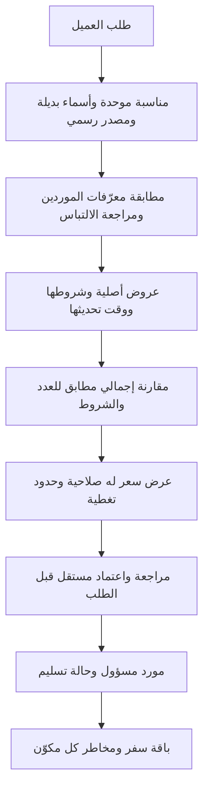

# إمكانات الجلسة والتدرج التقني — 2026-11-09

## ما تحقق في الجلسة

- المصدر المالك `A-awd/yoright`، الفرع المعتمد `migration/one-brain-foundation`، baseline `a946b49ee68936cbf687df1fe0ba2e106ab29f4f`. الخطة والقرار 0003 السابقان موجودان بهذا الفرع. توجيه ai-operating-system/main وPROJECT-ROUTING يؤكد YoRight؛ لم يثبت أن Uwrite اسم مطابق، ولم يُنقل إليه أو منه شيء.
- GitHub MCP متاح لقراءة الملفات والـcommits والتحديث؛ يوجد Git/CLI ونسخة عمل سحابية `/workspace/yoright`. تتم مراجعة التغييرات ونشرها ضمن تفويض إنشاء المهارة وحفظ الحالة؛ لا تغيير إعدادات المستودع أو دمج migration إلى main.
- فحص قائمة الأدوات لم يجد Browser `js` المحلي، ولا `cua_repl.js` أو أداة تشغيل سطح المكتب. حالة البيئة: provider=cloud، running، network unrestricted/enforced؛ remote_desktop enabled لكن state=unknown. لا يستنتج منها اتصال متصفح.
- Desktop Commander أعاد جهاز Mac مسجلًا بحالة Offline. لم يُشغّل عليه أمر ولم تُفتح ملفاته؛ لا وصول مثبت لحساباته أو جلساته أو iCloud.
- جرى إطلاق `/usr/bin/chromium` فعليًا عبر Playwright داخل البيئة السحابية، بملف جلسة مؤقت مستقل دون تسجيل دخول، وفُتحت صفحات التذاكر وأزرار العروض. هذا **متصفح سحابي معزول، وليس متصفح عبدالرحمن المحلي ولا إثباتًا أن عارض سطح المكتب يعمل**. تشغيله لا ينسخ جلساتك المحلية.
- Firecrawl Search/Scrape متاح للبحث المنشور وقراءة الصفحات؛ أظهر أيضًا قدرات مخزون StubHub وSeatGeek العامة. هذه القدرات لا تمثل checkout. نفد رصيد Firecrawl أثناء البحث؛ استمر البحث المستقل عبر Chromium وHTTP دون شراء رصيد أو اشتراك. لا يعد نفاد رصيد أداة دليلًا على حظر الموقع.
- لا يوجد في الأدوات المكتشفة موصل checkout متخصص مكتمل لهذه المنصات. غيابه لم يمنع البحث الداخلي بالمتصفح. لم يُستخدم Easy Life أو Start_Day أو Get_Run_Result.

## ما تستطيع المهارة فعله

المهارة تعليمات عمل مع سجل JSON ومدقق وتقرير؛ ليست زاحفًا دائمًا ولا نظام شراء آليًا. تحتاج في كل تشغيل إلى وكيل وأداة تصفح فعلية. يعاد اكتشاف الإمكانات كل جلسة، ويستخدم موصل مناسب عندما يكفي، ثم المتصفح لفحص ما لا يغطيه. الدخول أو التحقق البشري أو البيانات الشخصية المفقودة يعالج كعائق محدد؛ لا تُملأ بيانات وهمية لتجاوز الطلب ولا تنشأ حسابات أو تقبل شروط شراء.

ثُبتت المهارة في هذه البيئة برابط `/home/agent/.agents/skills/search-tickets` إلى المصدر؛ جرى فحص الرابط وقراءة SKILL.md منه. هذا لا يثبت تثبيتها على كمبيوتر المستخدم. يشرح README مسار Codex القابل للنسخ وطريقة الاستدعاء. المصدر الدائم في المستودع؛ ملفات العمل السحابية قد تكون مؤقتة. لم يثبت رفع إلى iCloud؛ GitHub هو موضع المصدر والكود المنقح.

## تصور تدريجي للمنتج (تصميم مقترح، غير منفذ)

| الكيان | بياناته الضرورية وضابطه |
| --- | --- |
| event | معرّف داخلي؛ النوع؛ الفريقان/الفنان؛ aliases عربية/إنجليزية/محلية؛ التاريخ والتوقيت والمنطقة الزمنية؛ المدينة/الدولة/الملعب؛ مصدر رسمي وتاريخ فحص. تغيير الموعد إصدار جديد، لا حذف للتاريخ القديم. |
| supplier_event | مورد + معرّفه + رابط عام + درجة المطابقة + سببها. لا دمج تلقائي إذا تعارض الفريق/التاريخ/الملعب؛ يسجل قرار المراجع. |
| offer | معرف عرض المورد؛ وصف المقعد الأصلي دائمًا؛ فئة موحدة منفصلة؛ عدد متاح/مسموح؛ تجاور مثبت؛ جمهور/هوية/عضوية/عمر؛ رؤية؛ ضيافة ومشتملات؛ طريقة وموعد التسليم؛ العملة؛ مكونات الإلزامي/الاختياري؛ السعر النهائي وحالته؛ وقت الفحص وانتهاء الصلاحية. |
| quote | طلب موحد + عروض مؤرخة + مصدر الصرف + جميع صفوف التغطية والعوائق؛ حفظ سبب الاختيار. السعر القديم ليس وعدًا بالحجز. يعاد التحقق من السعر والتوفر قبل أي إجراء مالي مصرح. |
| supplier_order | العرض/المورد المسؤول؛ idempotency ومطابقة تأكيد المورد؛ تسليم ومتابعة ودعم. حالات مقترحة: مسودة، بانتظار تأكيد السعر، بانتظار تأكيد المورد، مؤكد، بانتظار الإصدار، سُلّم، تأجيل، إلغاء، فشل تنفيذ، معالجة استرداد، مغلق. لا يسمى الطلب مؤكدًا باستجابة HTTP ناجحة وحدها. |
| package | ربط التذكرة والفندق والطيران والخدمات كالتزامات منفصلة، مع سياسة إلغاء وتوقيت دفع لكل مكون؛ لا ينتقل استرداد التذكرة آليًا إلى كامل الرحلة. |
| audit | زمن ومصدر ونسخة شروط وقرار مطابقة وتسعير وتغيير؛ الجمهور يرى المعلومات التي تساعده فقط. سجلات الطلب والهوية والدفع تحفظ خارج GitHub، بصلاحيات مناسبة. |

معادلة الجدوى المقترحة: هامش المساهمة = سعر بيعنا − تكلفة المورد النهائية − رسوم الدفع − كلفة الصرف − تكلفة الدعم/التسليم − مخصص الإخفاق/الإلغاء. الوديعة المستردة ورأس المال المحجوز منفصلان عن المصروف؛ لا يفترض هامش موجب أو نسبة ثابتة.

## مراحل تبدأ بنتيجة قابلة للقياس

1. الآن: طلب موحد + بحث يدوي بالمهارة + سجل تغطية ومدقق؛ لا قاعدة بيانات أو API أو موقع بيع جديد.
2. اختبار يدوي مقترح لـ10 طلبات على 2 وجهتين، يتضمن تذكرتين متجاورتين وفشل تسليم افتراضي. القياس: اكتمال الإجماليات، وقت تجهيز العرض، صلاحية السعر بعد إعادة الفحص، تطابق المقعد والتجاور، تكلفة الدعم ومخاطرة تغير الموعد. ليست هذه نتائج منجزة.
3. عند ثبوت قيمة العمل وحقوق التوزيع: أتمتة استيراد كتالوج واحد ثم مطابقة محافظة وعرض سعر وتحديث متدرج؛ احتفظ بعرض المورد الأصلي وبوقت تحديثه، ولا تعرض مخزونًا قديمًا على أنه متاح الآن.
4. اختيار API أو white label بعد عقد وبيانات اختبار مسموحة وتحقق اقتصادي؛ الأسعار/الودائع/SLA والقبول السعودي والبيع للوكالات والباقات تحتاج دليلًا مستقلًا. لا اختيار مورد أو تقنية نهائية في هذه الجلسة.
